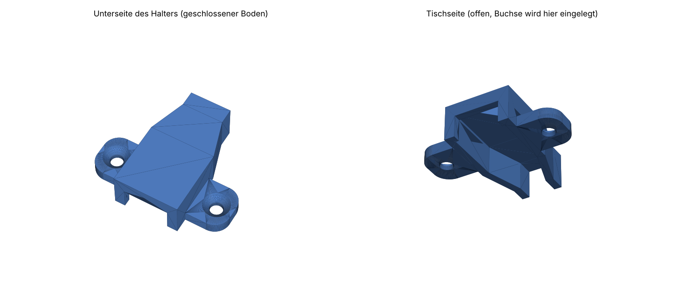

# USB-Buchsen-Halter für den Schreibtisch

3D-druckbarer Käfig, der die Buchse einer USB-Verlängerung unter der Tischplatte hält. Zwei seitliche Laschen mit Senkbohrung dienen zum Anschrauben.



## Inhalt

| Pfad | Inhalt |
|---|---|
| `docs/auftrag.md` | Aufgabenstellung, gemessene Maße, Anforderungen |
| `docs/konstruktion.md` | Konstruktionsentscheidungen, Parameter, Annahmen, Ausbaustufen |
| `src/usb_cage.py` | Parametrisches CadQuery-Modell, exportiert STEP und STL |
| `src/check_fit.py` | Passprüfung mit einer Attrappe der Buchse, Mesh-Check |
| `models/` | Exportierte Dateien (`usb_halter.stl`, `usb_halter.step`) |

## Modell neu erzeugen

```bash
pip install -r requirements.txt
python src/usb_cage.py        # schreibt nach models/
python src/check_fit.py       # Kollisionsprüfung und Mesh-Check
```

Maße und Toleranzen stehen am Anfang von `src/usb_cage.py`.

## Drucken

Das STL in der gelieferten Lage verwenden: Laschen flach auf dem Bett, offene Seite nach unten, keine Stützen. Empfohlen sind PETG oder PLA mit mindestens 3 Wänden. Zuerst eine kurze Passprobe drucken, um die Toleranzen am echten Teil zu prüfen.

## Montage

Buchse von der Tischseite einlegen, Metallteil durch den Vorderschlitz stecken, Kabel in den Kanal legen. Halter mit zwei Schrauben bis 4 mm unter den Tisch schrauben. Die Schraubenlänge muss kürzer sein als die Tischplattendicke minus 3,5 mm.

## Stand

Erste Version vom 2026-11-25. Passt rechnerisch auf die gemessenen Maße, ist aber noch nicht am echten Teil getestet. Offene Punkte stehen in `docs/konstruktion.md`.

## Lizenz

MIT, siehe [LICENSE](LICENSE). Die Lizenz gilt für Skripte, Dokumentation und die exportierten Modelle.
